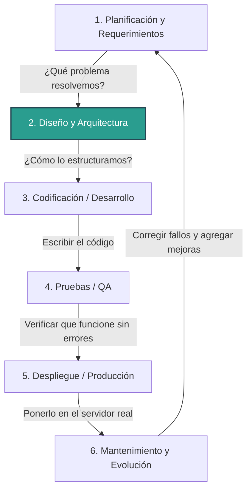

Para que la IA no suba archivo basura a git

# https://github.com/kunchenguid/no-mistakes

# SIGTRAM3 — Sistema de Gestión de Trámites Municipales (Versión 3)

Este proyecto representa la migración y modernización del sistema legacy `sigtram` (arquitectura tradicional N-Capas) hacia **SIGTRAM3**, utilizando Laravel 13, principios SOLID, y una arquitectura modular orientada a dominios (DDD/Clean Architecture).

---

## 🔄 Ciclo de Vida del Desarrollo de Software (SDLC)

El desarrollo del proyecto está estructurado en etapas lógicas de ingeniería. Actualmente nos encontramos en la **Fase de Diseño y Arquitectura** (Refactorización y sincronización de base de datos).

### Detalle de las fases en este proyecto:

1. **Planificación y Requerimientos:** Documentado en [planificacion_y_requerimientos.md](file:///c:/laragon/www/sigtram3/docs/planificacion_y_requerimientos.md). Contiene la especificación de alcance, metas de migración y requerimientos de calidad y seguridad.
2. **Diseño y Arquitectura (Fase Actual):** Estructura modular, inyección de dependencias y centralización de servicios descrita en [Arquitectura.md](file:///c:/laragon/www/sigtram3/docs/Arquitectura.md) y sincronización con el motor de pagos detallada en [sincronizacion_base_datos.md](file:///c:/laragon/www/sigtram3/docs/sincronizacion_base_datos.md).
3. **Codificación / Desarrollo:** Creación de controladores, servicios y repositorios por módulos de negocio (Expedientes, Mesa de Partes, Seguridad, etc.).
4. **Pruebas / QA:** Validación del motor de permisos y pruebas unitarias de controladores.

---

## 📂 Directorios de Documentación y Planos de la Arquitectura

Toda la documentación y especificaciones de la migración residen en la carpeta [docs/](file:///c:/laragon/www/sigtram3/docs/):

- **Planificación y Requisitos:** [planificacion_y_requerimientos.md](file:///c:/laragon/www/sigtram3/docs/planificacion_y_requerimientos.md) — Objetivos de migración, alcance funcional e integraciones.
- **Arquitectura de Software:** [Arquitectura.md](file:///c:/laragon/www/sigtram3/docs/Arquitectura.md) — Análisis de arquitectura, DDD, tematización por CSS dinámico e integraciones de Firma e Impresión.
- **Seguridad y Validaciones:** [analisis_validaciones_seguridad.md](file:///c:/laragon/www/sigtram3/analisis_validaciones_seguridad.md) — Reglas OWASP, control de accesos e inyección SQL.
- **Sincronización Multitenant:** [sincronizacion_base_datos.md](file:///c:/laragon/www/sigtram3/docs/sincronizacion_base_datos.md) — Coordinación de esquemas de base de datos y tareas con el proyecto de PAGOS.

### 🗄️ Scripts de Base de Datos (PostgreSQL):

- **Roles y Permisos:** [roles.sql](file:///c:/laragon/www/sigtram3/docs/sql/roles.sql) — DDL de control de accesos por cargo y excepciones individuales de usuario.
- **Esquema de Configuración Compartida:** [crear_tablas_configuracion.sql](file:///c:/laragon/www/sigtram3/docs/sql/crear_tablas_configuracion.sql) — Creación del esquema `config`, apariencias UI por tenant, y conexiones dinámicas.

---

## 🏛️ Servicios Centrales Transversales (Core Services)

SIGTRAM3 centraliza las operaciones complejas y transversales en módulos "núcleo" (Core Services) reutilizables por todos los módulos de negocio:

1.  **`AuthCore / SecurityCore`:** Control unificado de accesos por cargo con excepciones granulares a nivel de usuario en una sola consulta SQL (`LEFT JOIN` y `COALESCE`).
2.  **`BdCore`:** Centralización de conexiones a las 8 bases de datos secundarias del municipio con _Lazy Loading_ bajo demanda.
3.  **`NotificationCore`:** Canal de envío unificado (Email SMTP, WhatsApp vía Whapi y SMS) con colas de reintento.
4.  **`AuditCore`:** Bitácora de auditoría inmutable que registra las diferencias JSON antes y después de cada modificación (_State Diffing_).
5.  **`AdjuntosCore`:** Subida segura de archivos, enmascaramiento con hashes, validación de Mime-Type real y distribución modular diaria (`YYYY/MM/DD`).
6.  **`DocumentGeneratorCore`:** Motor de plantillas `.docx` con reemplazo de marcadores dinámicos y conversión desatendida a PDF final usando LibreOffice Headless en Linux.
7.  **`PideCore`:** Consulta en cascada de ciudadanos (DNI/RUC) priorizando: (1) API PIDE Oficial, (2) Base de datos local (caching), y (3) API Decolecta (con límites).
8.  **`FirmaCore`:** Integración con la plataforma Firma Perú (PCM) para firmas locales con Token/DNIe (vía ReFirma PC) y validación automatizada de firmas externas.
