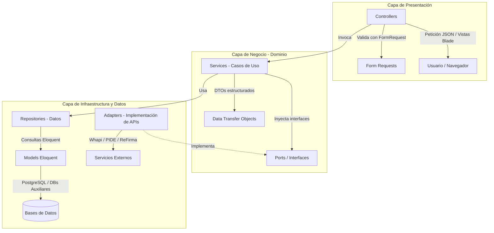
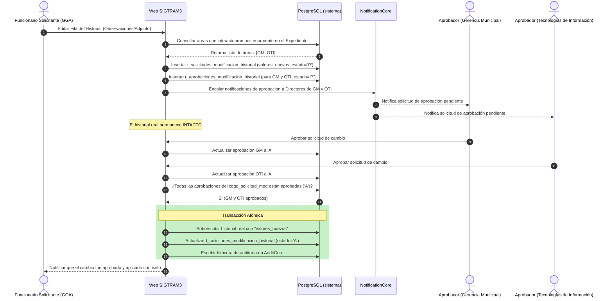
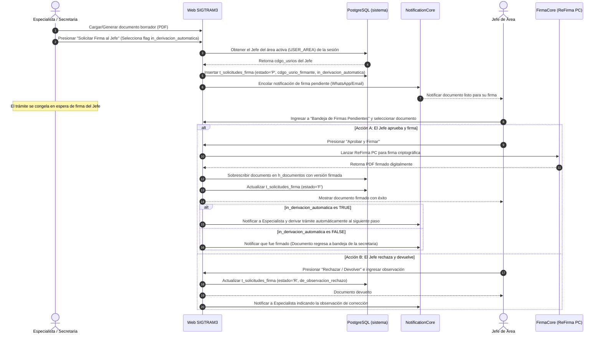
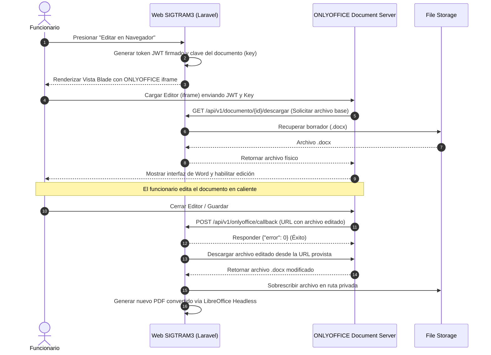

# Propuesta de Arquitectura y Escalabilidad: Migración de SIGTRAM a SIGTRAM3

**Contexto:** Migración del sistema legacy `sigtram` (Arquitectura N-Capas tradicional: Datos, Negocio, Presentación) a `sigtram3` (Framework Moderno - Laravel 13).

---

## 1. Análisis del Cambio Arquitectónico (De Legacy a Moderno)

El proyecto original `sigtram` refleja un patrón clásico de **N-Capas**. Si bien esto separa las responsabilidades, a menudo conduce a un alto acoplamiento y dificulta la mantenibilidad a medida que el sistema crece.

La migración a `sigtram3` (usando Laravel) representa un salto tecnológico fundamental. Sin embargo, para que el sistema sea verdaderamente **escalable a largo plazo**, no basta con mover el código a la estructura MVC por defecto de Laravel. Se requiere implementar una arquitectura modular basada en principios sólidos.

---

## 2. Arquitectura de Software y Diseño (Clean Architecture)

Recomiendo abandonar el enfoque MVC monolítico simple y evolucionar hacia una **Arquitectura Modular Orientada a Dominios (DDD)**.

### Propuesta Arquitectónica:

- **Módulos de Dominio (Modules/Domains):** En lugar de tener todos los controladores juntos, todos los modelos juntos, agrupar el código por **Contexto de Negocio** (Ej: `Módulo Expedientes`, `Módulo Pagos`, `Módulo Usuarios`).
- **Capas por Módulo:**
    - **Controllers (Presentación):** Solo reciben la petición HTTP, validan los datos (FormRequests) y pasan el control. **No deben tener lógica de negocio.**
    - **Services (Casos de Uso/Negocio):** Contienen la lógica de negocio pura. Orquestan operaciones y son completamente reutilizables.
    - **Repositories (Datos):** Abstraen las consultas complejas de Eloquent o DB. Si mañana cambiamos de base de datos o de ORM, solo tocamos el repositorio.
    - **DTOs (Data Transfer Objects):** Para pasar información estructurada entre controladores y servicios, garantizando el tipado estricto.
    - **Interfaces (Puertos):** Definen los contratos técnicos de los servicios que se consumen, aislando al núcleo de negocio de implementaciones concretas.
    - **Adapters (Infraestructura):** Implementaciones específicas que se conectan a herramientas o proveedores de terceros (ej: bases de datos, APIs de RENIEC/PIDE, Whapi) y traducen sus datos a DTOs.
    - **Eventos y Oyentes (Desacoplamiento):** Desacoplan los efectos secundarios (ej: notificaciones de WhatsApp, emails, generación de PDFs) de la transacción principal del negocio, ejecutándolos de forma asíncrona.



---

## 3. Centralización de Servicios como "Núcleos" (Core Services)

Para evitar duplicidad de código, garantizar la seguridad (OWASP) y fomentar la reutilización entre todos los módulos de `sigtram3`, se deben centralizar los servicios transversales como "Núcleos":

- **`AuthCore / SecurityCore`**: Gestión de tokens, sesiones, permisos granulares y excepciones.
    - **Diseño de Base de Datos Vinculado:** Para simplificar el control de accesos y evitar duplicidad de datos, la tabla de excepciones individuales `sistema.r_prmsos_usrios` se enlaza directamente mediante la clave foránea `cdgo_prmso` a la tabla base de permisos `sistema.r_prmsos` (con `ON DELETE CASCADE`).
    - **Cero Columnas de Acción Duplicadas:** La tabla base `sistema.r_prmsos` solo contiene el campo de estado `in_esta` (para activar/desactivar el menú completo al cargo). Las columnas de acción granular (`in_ver`, `in_crea`, `in_edit`, `in_elim`) se ubican únicamente en `sistema.r_prmsos_usrios`, donde la ausencia de registros de excepción para un usuario implica que posee acceso total por defecto.
    - **Consulta Unificada de una sola vuelta:** Se realiza un cruce mediante `LEFT JOIN` entre la tabla base de permisos (filtrada por el perfil, cargo y menú correspondiente) y la tabla de excepciones del usuario (filtrada por su login y estado activo). Utilizando la función `COALESCE`, se evalúan las cuatro acciones de forma simultánea (Ver, Crear, Editar, Eliminar): si existe un registro de excepción para el usuario, se adopta su valor específico (`'0'` o `'1'`); si no existe (lo que devuelve nulo), la función asigna automáticamente `'1'` (permitido) por defecto. Esto elimina la necesidad de realizar múltiples accesos ("doble vuelta") a la base de datos y permite almacenar la estructura resultante en la caché del sistema. Para ver la estructura del DDL correspondiente, referirse al script SQL de base de datos [roles.sql](file:///c:/laragon/www/sigtram3/docs/sql/roles.sql).
    - **Flujo del Algoritmo de Permisos:**
        ```mermaid
        graph TD
            Start([Usuario solicita recurso]) --> CacheCheck{¿Permisos en Caché?}

            CacheCheck -- Sí --> EvalAccess[Evaluar Permiso: Ver, Crear, Editar, Eliminar]

            CacheCheck -- No --> DBQuery[Consulta SQL Única LEFT JOIN]
            DBQuery --> JoinCheck{¿Tiene fila en r_prmsos_usrios?}

            JoinCheck -- No --> CoalesceDefault[COALESCE asigna '1' por defecto]
            JoinCheck -- Sí --> ExceptionValue[Adopta valor específico: '0' o '1']

            CoalesceDefault --> SaveCache[Guardar en Caché: user_perms_login]
            ExceptionValue --> SaveCache

            SaveCache --> EvalAccess

            EvalAccess --> Allow{¿Permitido?}
            Allow -- Sí --> AccessGranted[Acceso Concedido]
            Allow -- No --> AccessDenied[Acceso Denegado 403]
        ```
    - **Ejemplo Práctico de Validación:**
        - **José (Acceso Estándar):** José (`cdgo_lgin = 101`) tiene el cargo de _Asistente_. Al no existir ninguna fila para él en la tabla de excepciones `r_prmsos_usrios`, la consulta hace `COALESCE(NULL, '1')` y le otorga acceso total por defecto (Ver, Crear, Editar, Eliminar).
        - **Kliber (Excepción Individual):** Kliber (`cdgo_lgin = 102`) tiene el mismo cargo, pero se decide que no puede editar. Se registra una fila para él en `r_prmsos_usrios` asociada al `cdgo_prmso` correspondiente con `in_edit = '0'`. Al realizar la consulta, el `LEFT JOIN` encuentra su registro y le bloquea la edición (`in_edit` se evalúa en `'0'`), permitiéndole el resto de las acciones. Si en el futuro Kliber regresa a su comportamiento normal, basta con eliminar su registro de excepción o desactivarlo con `in_esta = '0'` para que el flujo pase directamente al comportamiento estándar del cargo.
- **`BdCore (Conexión a Bases de Datos Auxiliares)`**: Centralización y protección de accesos a las 8 bases de datos secundarias (SIMUN, SATMUNXP, SIGA, Asterisk, Cámaras, etc.).
    - **Variables de Entorno:** Todas las credenciales se eliminan de archivos php y se mueven al archivo `.env` seguro.
    - **Lazy Loading:** Las conexiones se abren bajo demanda; si el proceso actual no consulta Rentas (`SIMUN`), no se establece conexión TCP, evitando sobrecargar el servidor de base de datos.
- **`NotificationCore`**: Un servicio único capaz de enviar notificaciones por distintos canales (Email, WhatsApp vía Whapi con reintentos automáticos, SMS). Los demás módulos no inicializan cURL ni configuran PHPMailer directamente; solo llaman a `NotificationCore::send(...)`.
- **`AuditCore (Audit Trail)`**: Encargado de la bitácora de auditoría e inmutabilidad de datos.
    - **State Diffing:** Registra el estado de la fila antes y después del cambio (Diferencias JSON) de cada operación de modificación.
    - **Logs Estructurados:** Escribe logs formateados en JSON en disco para análisis automatizado.
    - **Contexto Automático:** Inyecta automáticamente el DNI, usuario, IP del terminal y fecha sin duplicar código en controladores.
- **`AdjuntosCore / GestorAdjuntos`**: Centralización de la gestión y subida de archivos adjuntos.
    - **Validación Robusta:** Validación centralizada de peso máximo, extensión y Mime-Type real (vía `fileinfo`).
    - **Distribución modular diaria:** Guarda automáticamente los archivos estructurando carpetas por fecha (`adjuntos/YYYY/MM/DD/`) para optimizar el filesystem.
    - **Enmascaramiento:** Renombra los archivos con hashes únicos (UUID o combinaciones estructuradas) previniendo ataques de Directory Traversal y colisiones.
- **`DocumentGeneratorCore`**: Motor central para la generación de borradores y resoluciones de trámites municipales basados en plantillas de oficina.
    - **Recomendación de Formato: `.docx` (Microsoft Word OpenXML):** Se recomienda usar `.docx` en lugar de `.odt` por su mayor compatibilidad con Microsoft Office (herramienta principal de la mayoría de funcionarios públicos) y el excelente soporte en PHP mediante librerías como **`PhpWord`** para manipular layouts complejos, sangrías y tablas sin romper el formato.
    - **Organización Modular de Plantillas:** Para mantener el orden, se estructurarán de manera modular dentro del almacenamiento privado de Laravel:
      `storage/app/plantillas/mod_<area>/{nombre_plantilla}.docx` (ej: [storage/app/plantillas/mod_gdu/](file:///c:/laragon/www/sigtram3/storage/app/plantillas/mod_gdu/) para el módulo de Urbanismo).
    - **Compatibilidad e Instalación en Linux (Servidores de Producción/Docker):**
      PHPWord funciona de forma totalmente nativa en Linux. La conversión automática a PDF se realiza invocando a LibreOffice en modo _headless_ (sin entorno gráfico). En servidores Ubuntu/Debian o en el contenedor Docker de producción, esto requiere únicamente instalar la utilidad básica de conversión (`libreoffice-writer` sin interfaz de usuario) a través del gestor de paquetes del sistema operativo.
    - **Ejemplo Práctico de Generación (Módulo de Urbanismo - GDU):**
        1. **La Plantilla Base (`.docx`):** El administrador sube a `storage/app/plantillas/mod_gdu/resolucion_licencia.docx` un documento Word con marcadores (placeholders) como: `${NRO_EXPEDIENTE}`, `${CITADINO}`, `${RUC}`, `${DIRECCION}`, `${GIRO_COMERCIAL}`.
        2. **Doble Capacidad (Borrador Word y PDF Final) en `DocumentGeneratorService`:**
           El servicio cuenta con dos componentes o métodos clave para procesar el trámite:
            - **Generación del Borrador Word (`.docx`):** Toma la plantilla de Urbanismo, carga los datos del trámite y el solicitante a través del procesador de plantillas (PHPWord), crea un documento con los marcadores reemplazados en la ruta estructurada por fecha del almacenamiento privado (`storage/app/documentos/internos/YYYY/MM/DD/`), y retorna la ruta para que el usuario pueda descargar el archivo Word editable y realizar modificaciones manuales.
            - **Conversión a PDF Final (`.pdf`):** Recibe la ruta del archivo `.docx` (ya sea el borrador original o el Word modificado que el usuario volvió a subir), crea la carpeta de salida correspondiente y ejecuta mediante un comando del sistema la conversión headless de LibreOffice (`soffice --headless --convert-to pdf`). Tras validar el éxito del comando, devuelve la ubicación del PDF generado para su visualización o firma digital.
        3. **Resultado y UX (Dos Canales de Operación):**
            - **Flujo Directo (Sin descargas):** Si los datos generados automáticamente en el borrador son correctos, el funcionario presiona directamente **"Generar Documento Oficial (PDF)"**, el servidor realiza la conversión inmediata en segundo plano y el usuario procede a la firma digital (local o en nube) en una sola pantalla.
            - **Flujo con Edición (Modo Manual):** Si el funcionario necesita realizar correcciones, presiona **"Descargar Borrador (Word)"**, edita el archivo localmente en Microsoft Word, guarda los cambios, presiona **"Subir Word Corregido"** para actualizar el borrador del trámite, y finalmente presiona **"Generar Documento Oficial (PDF)"** para habilitar la firma digital sobre la versión corregida.
- **`PideCore`**: Un único servicio centralizado para la consulta de información de ciudadanos (DNI/RUC). Debe orquestar la consulta en cascada en el siguiente orden de prioridad: (1) **API PIDE Oficial** (RENIEC, SUNAT y SUNARP), (2) **Base de Datos Local** (SIGTRAM, para ahorrar consultas externas y cuotas), y (3) **API Decolecta** (API externa gratuita con límite de 100 consultas mensuales, como último recurso en caso de que PIDE oficial haya caído y los datos no existan localmente). Cada canal estará gobernado por variables en el archivo `.env` (`PIDE_USAR_OFICIAL`, `PIDE_USAR_LOCAL`, `PIDE_USAR_DECOLECTA`) para encendido/apagado en caliente, aplicando además un timeout estricto de **3 a 5 segundos** para evitar bloqueos del servidor.
- **`FirmaCore (Integración con Firma Perú)`**: Servicio transversal para la aplicación de firmas digitales en documentos oficiales (PDF) mediante la [Plataforma Nacional de Firma Digital (Firma Perú)](https://www.gob.pe/22271-acceder-a-la-plataforma-nacional-de-firma-digital-firma-peru). Se implementa utilizando el componente [Firmador](https://www.gob.pe/22273) y el agente desktop **ReFirma PC**:
    - **Firma Local (Modo Local con Token USB / DNIe):**
        - **Funcionamiento (Costo Cero):** Orientado a funcionarios que trabajan desde las oficinas en sus estaciones de trabajo. El componente web invoca al agente local (_ReFirma Componente_) en la PC del usuario para leer el certificado desde un token físico o lector de DNIe, solicitando localmente el PIN criptográfico.
        - **Ventaja principal:** Costo cero por transacción al ser firmas directas por hardware provistas gratuitamente por la PCM, manteniendo la clave privada bajo custodia física del funcionario. No compatible con celulares o tablets.
    - **Validación de Firmas de Terceros (Validador de Firma Perú - PCM):**
        - **Funcionamiento:** Para los documentos digitales subidos por administrados o proveedores externos en la Mesa de Partes Virtual, el sistema consume el componente **Validador de Firma Perú** provisto por la PCM para verificar de forma automatizada y desatendida la validez de la firma digital y el estado del certificado. En caso de que la firma esté dañada o sea inválida, pero se requiera forzar su aprobación por decisión administrativa, el sistema solicitará obligatoriamente la clave de autorización del Jefe de Área (o el rol delegado correspondiente).
    - **Flujo Secuencial de Generación y Firma de Trámites:**

        ```mermaid
        sequenceDiagram
            autonumber
            actor Funcionario
            participant Sistema as Web SIGTRAM3
            participant Engine as DocumentGeneratorCore
            participant Office as LibreOffice Headless
            participant Sign as FirmaCore

            Funcionario->>Sistema: Solicitar Licencia / Trámite
            Sistema->>Engine: Procesar datos del trámite
            Engine->>Engine: Leer plantilla resolucion_licencia.docx
            Engine->>Engine: Reemplazar marcadores dinámicos
            Engine->>Sistema: Retornar Borrador Word (.docx)
            Sistema->>Funcionario: Ofrecer descarga de Borrador
            Note over Funcionario: Edición manual en Word si es necesario
            Funcionario->>Sistema: Subir Word editado (opcional)
            Funcionario->>Sistema: Solicitar PDF Oficial
            Sistema->>Office: Convertir Word (.docx) a PDF (.pdf)
            Office->>Sistema: Retornar PDF no-editable
            Funcionario->>Sistema: Solicitar Firma Digital
            Sistema->>Sign: Invocar LocalAgent ReFirma PC (WebSocket)
            Sign->>Funcionario: ReFirma PC solicita PIN y selección de token
            Funcionario->>Sign: Ingresa PIN y firma en su PC
            Sign->>Sistema: Retornar PDF firmado
            Sistema->>Funcionario: Mostrar documento firmado oficial
        ```

- **Inyección de Dependencias (DI):** Estos núcleos deben registrarse en el `ServiceContainer` de Laravel para ser inyectados en cualquier parte de la aplicación (Principio de Inversión de Dependencia).

---

## 3.1. Flujo Especial: Aprobación Colectiva para Modificaciones en el Histórico

Para garantizar la integridad e inmutabilidad de los expedientes municipales, cualquier modificación del historial solicitada por un área (por ejemplo, corrección de observaciones o actualización de documentos adjuntos) que posea registros posteriores en la línea de tiempo, requiere la **aprobación unánime de todas las áreas subsecuentes**.

### Diseño de Base de Datos para el Control de Cambios:

Para implementar este flujo sin alterar la consistencia de los datos en caliente, se diseñan dos tablas en el esquema `sistema`:

#### 1. Tabla de Solicitudes (`sistema.t_solicitudes_modificacion_historial`):
*   `cdgo_solicitud_mod` (BIGSERIAL PRIMARY KEY)
*   `cdgo_historial_origen` (BIGINT NOT NULL REFERENCES sistema.h_expedientes_movimientos(cdgo_movimiento) ON DELETE CASCADE)
*   `cdgo_usrio_solicitante` (INTEGER NOT NULL REFERENCES sistema.p_usrios(cdgo_usrios))
*   `valores_nuevos` (JSONB NOT NULL) — Almacena en formato clave-valor los campos modificados (ej: `{"de_observacion": "Nueva observación corregida"}`).
*   `archivos_nuevos` (JSONB NULL) — Almacena la ruta y metadatos de los nuevos archivos adjuntos propuestos.
*   `estado_solicitud` (bpchar(1) NOT NULL DEFAULT 'P') — Estados: `'P'` (Pendiente), `'A'` (Aprobado y Aplicado), `'R'` (Rechazado).
*   `nu_dias_habiles_limite` (INTEGER NULL) — Días hábiles límite para responder. Si es NULL o vacío, no hay límite de tiempo.
*   *Auditoría:* `cdgo_usrios_ins`, `fec_ins`, `cdgo_usrios_upd`, `fec_upd`.

#### 2. Tabla de Aprobaciones Colectivas (`sistema.r_aprobaciones_modificacion_historial`):
*   `cdgo_aprobacion` (BIGSERIAL PRIMARY KEY)
*   `cdgo_solicitud_mod` (BIGINT NOT NULL REFERENCES sistema.t_solicitudes_modificacion_historial(cdgo_solicitud_mod) ON DELETE CASCADE)
*   `cdgo_area_aprobador` (INTEGER NOT NULL REFERENCES sistema.a_areas(cdgo_area)) — Área que debe validar el cambio.
*   `estado_aprobacion` (bpchar(1) NOT NULL DEFAULT 'P') — Estados: `'P'` (Pendiente), `'A'` (Aprobado), `'R'` (Rechazado).
*   `cdgo_usrio_aprobador` (INTEGER NULL REFERENCES sistema.p_usrios(cdgo_usrios)) — Funcionario que valida el cambio.
*   `fec_aprobacion` (TIMESTAMP WITH TIME ZONE NULL)
*   *Restricción:* Clave única compuesta `UNIQUE (cdgo_solicitud_mod, cdgo_area_aprobador)` para evitar duplicidad de solicitudes de aprobación por área.

### Flujo de Ejecución (Secuencia de Aprobación):

El siguiente diagrama detalla cómo se gestiona la solicitud de cambio y cómo se integra con el núcleo de notificaciones y la transacción final:



### 3.2. Flujo Especial: Firma Jerárquica Delegada (Visto Bueno del Jefe)

Para el proceso de emisión de documentos oficiales, los especialistas y secretarias redactores no poseen atribuciones de firma final. Se implementa un **flujo de firma jerárquica** donde el personal administrativo solicita el visto bueno y firma del Jefe de su área para dar validez al documento.

#### Diseño de Base de Datos para Solicitudes de Firma:

Se define una tabla central en el esquema `sistema` para gobernar las solicitudes de firmas y sus estados:

##### Tabla de Solicitudes de Firma (`sistema.t_solicitudes_firma`):
*   `cdgo_solicitud_firma` (BIGSERIAL PRIMARY KEY)
*   `cdgo_documento` (BIGINT NOT NULL REFERENCES sistema.h_documentos(cdgo_documento) ON DELETE CASCADE) — Referencia al documento borrador PDF generado.
*   `cdgo_usrio_solicitante` (INTEGER NOT NULL REFERENCES sistema.p_usrios(cdgo_usrios)) — Especialista/secretaria que preparó el documento.
*   `cdgo_usrio_firmante` (INTEGER NOT NULL REFERENCES sistema.p_usrios(cdgo_usrios)) — ID del Jefe de área asignado para firmar.
*   `in_derivacion_automatica` (BOOLEAN NOT NULL DEFAULT FALSE) — Flag para indicar si tras la firma se deriva automáticamente al siguiente destinatario (TRUE) o si regresa a la bandeja de la secretaria para revisión/anexos (FALSE).
*   `estado_solicitud` (bpchar(1) NOT NULL DEFAULT 'P') — Estados: `'P'` (Pendiente de Firma), `'F'` (Firmado y Completado), `'R'` (Rechazado y Devuelto para corrección).
*   `de_observacion_rechazo` (TEXT NULL) — Detalle de por qué el Jefe devolvió el documento (en caso de rechazo).
*   `nu_dias_habiles_limite` (INTEGER NULL) — Días hábiles límite para firmar el documento. Si es NULL o vacío, no hay límite.
*   *Auditoría:* `cdgo_usrios_ins`, `fec_ins`, `cdgo_usrios_upd`, `fec_upd`.

#### Flujo de Ejecución (Secuencia de Solicitud y Firma):



### 3.3. Integración con ONLYOFFICE Document Server (Fase 2 — Edición Integrada)

Para elevar la experiencia de usuario y eliminar el flujo manual de descarga y subida de archivos `.docx`, se diseñará e implementará la integración con **ONLYOFFICE Document Server** en la **Fase 2** del proyecto.

#### Flujo de Arquitectura (ONLYOFFICE & Laravel):
1. **Petición de Edición:** El usuario presiona "Editar en Navegador" en un documento Word del trámite.
2. **Generación de Configuración:** Laravel genera un identificador de documento único (`key`), firma el payload de configuración con un token JWT (seguridad contra alteración) y carga una vista Blade con el editor Javascript de ONLYOFFICE en un `<iframe>`.
3. **Carga en ONLYOFFICE:** El Document Server de ONLYOFFICE (alojado en un contenedor Docker municipal) solicita el archivo original a la API de Laravel y lo muestra en pantalla.
4. **Edición Colaborativa:** El usuario realiza cambios directamente en el navegador de forma fluida.
5. **Guardado (Callback):** Cuando el usuario cierra el documento o transcurre el tiempo de guardado automático, ONLYOFFICE realiza una llamada asíncrona de retorno (callback) al controlador de Laravel (`/api/v1/onlyoffice/callback`).
6. **Actualización del Archivo:** Laravel recibe el JSON de ONLYOFFICE con el link de descarga del archivo modificado, descarga el nuevo `.docx` de forma segura, reemplaza la versión anterior en `storage/app/documentos/` y actualiza la base de datos.



---

## 4. UX/UI, Estilos y Arquitectura de Diseño (Modo Light/Dark)

El sistema debe sentirse como una aplicación **premium, ágil y moderna (SPA - Single Page Application)**.

### Sistema de Diseño (Design System):

1.  **Tokens de Diseño (CSS Variables):** No utilizar colores en código duro (hardcoded). En lugar de usar `#1a202c`, usar variables como `var(--color-primary)`.
2.  **Tailwind CSS (Recomendado):** Laravel se integra nativamente con Tailwind. Debemos configurar el archivo `tailwind.config.js` para usar estos tokens.
3.  **Implementación del Modo Oscuro/Claro (Con un Botón):**
    - Al usar Tailwind y CSS Variables, el cambio de tema se logra añadiendo o quitando una clase (ej. `dark`) en la etiqueta `<html>`.
    - El estado del tema elegido por el usuario se guarda en `localStorage` o en la base de datos (preferencias del usuario).
4.  **Componentes UI Reutilizables:**
    - Crear una librería de componentes frontend (Botones, Tablas, Modales, Formularios) reutilizando el núcleo visual. Si se actualiza el diseño del "Botón Primario", se actualiza en todo el sistema.
5.  **Micro-interacciones:** Retroalimentación visual inmediata en las acciones (hover states, loaders al enviar formularios, skeleton screens durante la carga de datos).
6.  **Diseño Responsivo (Mobile-First/Adaptativo):** Toda interfaz, formulario, tabla de datos y modal debe estar optimizado para adaptarse a diferentes tamaños de pantalla (móviles, tablets y pantallas de escritorio), garantizando una experiencia de usuario fluida y usable en cualquier dispositivo.
7.  **Tematización Dinámica por Entidad (Multi-empresa):** Para soportar múltiples entidades municipales o dependencias que comparten la plataforma (ej. _Municipalidad de Puente Piedra_ con verde institucional, _Palacio de la Cultura_ con azul/dorado), los colores base y logotipos se configuran dinámicamente:
    - **Base de Datos:** Los colores y el logotipo se leen de forma dinámica desde la tabla compartida `config.configuracion_ui` (relación 1-1 con `sistema.a_cmpnias` mediante el campo `cdgo_cmpnia`). Esto centraliza los parámetros visuales en un esquema dedicado sin alterar la estructura de la tabla de compañías central. (Ver script de base de datos en [crear_tablas_configuracion.sql](file:///c:/laragon/www/sigtram3/docs/sql/crear_tablas_configuracion.sql)).
    - **Inyección de CSS Dinámico:** Durante el arranque de la aplicación (vía middleware o layout principal Blade), el sistema consulta los datos de la compañía guardada en la sesión del usuario (`session('usComp')`). Estos colores se inyectan en la etiqueta `<style>` del `<head>` como variables CSS nativas (`:root { --color-primary: ... }`).
    - **Consistencia Visual:** El framework Tailwind CSS y las clases utilitarias consumen estas variables directamente, adaptando automáticamente toda la paleta de colores de botones, menús, bordes y tipografías al estilo de la entidad del funcionario activo sin necesidad de recompilar assets.

---

## 5. Aplicación de Clean Code (Código Limpio) y Nomenclatura

Es imperativo establecer reglas de desarrollo y nomenclatura estrictas para todo el equipo de `sigtram3`:

### A. Idioma del Código de Negocio (Español)
Se utilizará el idioma **español** para todas las lógicas, definiciones y rutas que representen conceptos del negocio municipal:
* **Controladores y Rutas:** Ej: `ExpedienteController`, `ResolucionController`, `/v1/tramites/crear`.
* **Servicios e Interfaces (Puertos):** Ej: `FirmaDocumentoService`, `ExpedienteRepositoryInterface`.
* **Abreviaciones Permitidas:** Se recomienda usar abreviaciones estándar y cortas (ej: `doc`, `usr`/`usrio`, `reg`, `notif`, `config`) para evitar nombres excesivamente largos (ej. usar `guardarRegComUsrio()` en lugar de `guardarRegistroCompletoDelUsuario()`).
* **Métodos, Parámetros y Variables:** Todos los nombres de funciones y variables internas del negocio se escribirán en español.

### B. Directorios y Estructura Técnica (Inglés)
Las carpetas físicas del framework, los namespaces PSR y los componentes técnicos del framework Laravel se mantendrán en **inglés**:
* Ej: `app/Http/Controllers/`, `app/Services/`, `app/Repositories/Contracts/`, `app/Providers/`.

### C. Buenas Prácticas Técnicas
* **Tipado Estricto (Strict Types):** Declarar obligatoriamente `declare(strict_types=1);` en la primera línea de todos los archivos PHP nuevos o modificados.
* **Early Returns (Retornos Tempranos):** Comprobar condiciones de error o salida rápida primero para evitar indentación excesiva y mejorar la legibilidad del código.
* **Herramientas de Calidad Automatizadas:**
  * **Laravel Pint / PHP_CodeSniffer:** Para aplicar formateo automático de código antes de realizar commits.
  * **PHPStan / Larastan:** Análisis estático ejecutado obligatoriamente en nivel 5 para detectar errores de tipos de datos antes del despliegue.

---

## 6. Seguridad Avanzada

Siendo un sistema gubernamental o corporativo crítico, la seguridad no es opcional:

1.  **Protección de Rutas y APIs:** Uso de Laravel Sanctum o JWT para autenticación sin estado (Stateless) si hay API, o manejo robusto de sesiones con rotación de IDs para prevenir _Session Hijacking_.
2.  **RBAC Fuerte (Control de Acceso Basado en Roles):** Implementar permisos granulares usando **Gates y Policies nativas de Laravel** consultando las tablas propias del sistema (`sistema.r_prmsos` + `sistema.r_prmsos_usrios`). No se usa `spatie/laravel-permission` ya que es incompatible con la base de datos preexistente (viola DB-04). Ver implementación en `docs/ejemplos/session_keys_example.php`.
3.  **Seguridad Base de Datos & Conexiones:** No utilizar el usuario administrador (`postgres` / `root`) para las conexiones de la aplicación (Principio de Menor Privilegio). Cifrar la comunicación mediante SSL/TLS entre Laravel y las bases de datos (PostgreSQL, MySQL, SQL Server) y usar el Query Builder o Eloquent con bindings de PDO para prevenir **SQL Injection**.
4.  **Rate Limiting & Prevención de Doble Envío:** Prevenir ataques de fuerza bruta y DDoS limitando las peticiones por IP/Usuario usando el middleware `throttle` de Laravel. Para acciones transaccionales críticas (ej: registrar trámites, crear expedientes, procesar pagos), es obligatorio implementar candados atómicos de caché (`Cache::lock`) en el backend para evitar inserciones duplicadas por solicitudes concurrentes o evasiones del frontend.
5.  **Sanitización & Validación de Inputs:** Todo input del usuario debe ser validado por un `FormRequest` estricto y escapado en las vistas (`{{ $variable }}` previene XSS).
6.  **Trazabilidad y Auditoría de Datos:** Implementar logs de auditoría inmutables en base de datos o almacenamiento seguro para registrar toda acción crítica (quién creó, modificó o eliminó un expediente/registro, desde qué IP y a qué hora).
7.  **Cumplimiento de Protección de Datos Personales (Ley N° 29733 - Perú):** Por defecto, la información se almacenará en texto plano para mantener compatibilidad. Sin embargo, se recomienda cifrar columnas altamente confidenciales (DNI, teléfonos, direcciones) mediante los métodos de encriptación nativos de Laravel (casteo `encrypted` o facade `Crypt`) y obtener consentimiento explícito cuando corresponda.
8.  **Gestión Segura de Carga de Archivos (Adjuntos):** Validar el Mime-Type real de los archivos (no solo la extensión). Se renombrarán utilizando hashes únicos e inmutables. Es obligatorio **organizarlos y almacenarlos de forma privada y estructurada por fecha/día (`YYYY/MM/DD`)** bajo las siguientes carpetas en `storage/app/` para evitar degradación de rendimiento del filesystem:
    - **Trámites Externos:** `storage/app/documentos/externos/YYYY/MM/DD/` (para adjuntos subidos por ciudadanos).
    - **Trámites Internos:** `storage/app/documentos/internos/YYYY/MM/DD/` (para informes, derivaciones y proveídos municipales).
    - **Documentos Generados:** `storage/app/documentos/generados/YYYY/MM/DD/` (para resoluciones, licencias y constancias emitidas).
    - **Archivos Temporales:** `storage/app/temporal/YYYY/MM/DD/` (purgados automáticamente).
    - _Regla de Seguridad:_ Queda prohibido exponerlos directamente en la carpeta pública del servidor web. Las descargas se realizarán a través de un controlador seguro de Laravel (`Storage::download()`) que valide el control de accesos del usuario logueado. Implementar un sistema de escaneo de antivirus (ej. ClamAV) en el servidor antes de guardarlos.
9.  **Seguridad de Infraestructura y Host:** Desplegar con cabeceras de seguridad HTTP (CSP, HSTS, X-Frame-Options), colocar un WAF (Web Application Firewall como Cloudflare/ModSecurity) y configurar los contenedores Docker para correr bajo un usuario no-root.

### Prevención de Principales Vulnerabilidades Web (OWASP Top 10 - 2025)

Para que la web sea verdaderamente robusta, se implementarán defensas contra las 10 vulnerabilidades más críticas de la industria bajo el estándar de seguridad más reciente (**OWASP Top 10:2025**):

- **A01: Fallas de Control de Acceso (Broken Access Control):** Sigue siendo la vulnerabilidad #1. Uso estricto de _Policies_ y _Gates_ en Laravel para asegurar que un usuario no pueda ver, editar o borrar registros ajenos manipulando la URL o IDs en el Request. Adicionalmente, se mitigan riesgos de tipo SSRF (ahora consolidado en esta categoría).
- **A02: Configuraciones Inseguras (Security Misconfiguration):** Sube al puesto #2. Jamás desplegar con `APP_DEBUG=true` en producción. Configurar correctamente cabeceras HTTP de seguridad (HSTS, CSP, X-Frame-Options) y restringir el webroot únicamente a la carpeta `public/`, aislando el archivo `.env`.
- **A03: Fallas en la Cadena de Suministro de Software (Software Supply Chain Failures):** Nueva categoría crítica. Reemplaza y amplía la de componentes desactualizados. Implica mantener políticas estrictas de auditoría de paquetes con `composer audit` y `npm audit` en el pipeline de CI/CD para evitar dependencias comprometidas o maliciosas.
- **A04: Fallos Criptográficos (Cryptographic Failures):** Todo el tráfico debe viajar bajo HTTPS (SSL/TLS). Las contraseñas se almacenarán de forma segura con `Hash::make()`. Para la transición desde el sistema legacy, el módulo de autenticación de `sigtram3` implementará un mecanismo de migración transparente: si la verificación con Bcrypt falla pero coincide con el hash SHA1 heredado, la contraseña se actualizará automáticamente en la base de datos usando Bcrypt y se otorgará el acceso sin requerir un blanqueo de contraseñas. Para los datos altamente sensibles (DNI, celular, dirección), por defecto se almacenarán en texto plano para mantener la compatibilidad, recomendando encarecidamente su encriptación mediante el cifrado AES-256 nativo de Laravel (`Crypt::encryptString` o el casteo `'encrypted'`).
- **A05: Inyección (SQL/NoSQL/Command Injection):** Se prohíbe el uso de `DB::raw()` con variables no sanitizadas. Eloquent y el Query Builder utilizan bindings PDO por defecto para neutralizar ataques de inyección SQL.
- **A06: Diseño Inseguro (Insecure Design):** Aplicación de una arquitectura de "Cero Confianza" (Zero Trust) desde la fase de diseño. Las rutas, APIs e inputs deben estar bloqueados y validados por defecto mediante validadores robustos y middlewares de autorización.
- **A07: Fallos de Autenticación (Authentication Failures):** Validaciones exigentes de contraseñas (`Password::defaults()`), rate limiting en el login para mitigar fuerza bruta y obligatoriedad de autenticación multifactor (MFA) para roles críticos (como administración de TI).
- **A08: Fallas en la Integridad del Software y de los Datos (Software or Data Integrity Failures):** Validar la integridad del código en los despliegues usando firmas de `composer.lock` y asegurar que los archivos subidos al sistema (`Storage`) no contengan payloads maliciosos.
- **A09: Fallos en el Registro y Alertas de Seguridad (Security Logging and Alerting Failures):** Configurar logs estructurados e implementar centralización y monitoreo de logs (ej. Sentry, Bugsnag) que generen alertas inmediatas ante picos de errores 401/403 o comportamientos anómalos.
- **A10: Manejo Incorrecto de Condiciones Excepcionales (Mishandling of Exceptional Conditions):** Nueva categoría orientada a cómo responde el sistema ante errores. Evitar mostrar stack traces detallados al usuario final, implementando páginas de error personalizadas (404, 500, 403) y asegurando que las excepciones fallen de manera segura (fail-secure).
- **Prevención CSRF (Mención Especial):** Mantener habilitada la protección nativa de Laravel (`@csrf`) para evitar ataques de falsificación de solicitudes desde sitios de terceros.

---

## 7. Escalabilidad, Rendimiento y QA

Para garantizar que el sistema soporte picos de usuarios y grandes volúmenes de datos:

### Bases de Datos y Caché

- **Caché Centralizada (Redis/Memcached):** No hacer consultas pesadas (como conteo total de expedientes o reportes maestros) en cada petición. Guardar resultados complejos en Redis. Asimismo, para optimizar el rendimiento y evitar múltiples consultas redundantes de seguridad por petición (doble vuelta), se pre-compilarán los permisos granulares del usuario (base de `r_prmsos` y excepciones de `r_prmsos_usrios`) en la caché de Laravel (`Cache::remember`) usando la llave `user_perms_{cdgo_lgin}`. Esta caché se invalidará de manera inmediata (`Cache::forget`) cada vez que se modifique la matriz de permisos o las excepciones en el panel de administración.
- **Índices Estratégicos:** Optimizar tablas grandes aplicando índices en columnas usadas frecuentemente en condicionales `WHERE` y `JOIN`.
- **Transaccionalidad (Atomicidad):** Toda operación compleja que escriba en múltiples tablas (ej. crear trámite + guardar movimientos) debe estar envuelta obligatoriamente en transacciones de base de datos (`DB::transaction(...)`) para evitar inconsistencias de datos en caso de errores a mitad de proceso.
- **Correlativos Seguros:** La generación de números correlativos (ej: expedientes) debe realizarse mediante secuencias nativas de PostgreSQL en lugar de consultas de conteo en código PHP, evitando colisiones por concurrencia. Se debe auditar si algún módulo carece de secuencias en base de datos.
- **Eliminaciones Lógicas (Soft Deletes):** Queda prohibida la eliminación física de registros históricos o transaccionales. Se debe marcar el registro con estado `0` o `false` según la estructura definida de la tabla para conservar la auditoría del dato.
- **Mapeo de Esquemas en Modelos Eloquent:** Debido a que la base de datos de la municipalidad utiliza múltiples esquemas PostgreSQL (`sistema`, `ti`, `licencias`, etc.), todos los modelos Eloquent de `sigtram3` deben declarar de forma explícita el esquema en la propiedad `$table` y la clave primaria heredada, evitando renombrar las tablas y columnas físicas del motor de base de datos para no alterar la compatibilidad con el sistema legacy.
  
  **Tabla de Mapeo de Nombres Históricos a Modelos:**
  
  | Tabla Física (PostgreSQL) | Nombre en Modelo Laravel | Clave Primaria Física |
  | :--- | :--- | :--- |
  | `sistema.p_lgin` | `Login` (o `Usuario`) | `cdgo_lgin` |
  | `sistema.a_cmpnias` | `Compania` | `cdgo_cmpnia` |
  | `sistema.a_areas` | `Area` | `cdgo_area` |
  | `sistema.p_usrios` | `UsuarioPersonal` | `cdgo_usrios` |
  
  *Ejemplo:*
  ```php
  protected $table = 'sistema.p_lgin';
  protected $primaryKey = 'cdgo_lgin';
  ```
- **Prohibición de Cambios de Esquema y Migraciones Automáticas:** Al ser una base de datos preexistente y compartida con el monolito activo de la municipalidad, queda estrictamente prohibida la ejecución de migraciones automáticas (`php artisan migrate`) o comandos DDL directos en la base de datos por parte de la aplicación, desarrolladores o IA de manera automática o por error. Cualquier alteración de tablas, nuevas columnas o secuencias debe ser provista como un script SQL documentado en la carpeta `doc/` para su aprobación y posterior ejecución manual por el Administrador de TI desde DBeaver. No se debe intentar ejecutar DDL de forma automática.


### Procesamiento en Segundo Plano (Colas / Queues)

- **Trabajos Asíncronos:** Toda tarea que demore más de 1 segundo (ej: envío masivo de correos, generación de reportes en PDF/Excel pesados, consumo de APIs externas) **NO debe bloquear al usuario**. Se deben encolar usando Laravel Queues con **Redis** (`QUEUE_CONNECTION=redis`) y monitorear el rendimiento en tiempo real utilizando **Laravel Horizon**, mostrando una notificación al usuario cuando terminen.

### QA (Quality Assurance)

- **Testing Automatizado:** Es obligatorio implementar **Pruebas Unitarias (Pest / PHPUnit)** para la capa de servicios (núcleos) y **Pruebas de Funcionalidad (Feature Tests)** para asegurar que los endpoints devuelven lo esperado. Una cobertura mínima del 80% en los flujos críticos.
- **CI/CD (Integración y Despliegue Continuo):** Las pruebas y el análisis de Clean Code deben correr automáticamente al subir código (Github Actions / Gitlab CI). Si falla, el código no se fusiona a la rama principal.

### Diseño Tolerante a Actualizaciones (Upgradability by Design)

Para garantizar que el sistema pueda escalarse y actualizarse a versiones futuras de Laravel (ej. Laravel 14, 15, etc.) y PHP de forma indolora en los próximos años, se adoptan los siguientes principios de diseño:

- **Desacoplamiento de Librerías Externas (Wrappers / Adaptadores):** Las librerías de terceros (por ejemplo, generadores de PDF, lectores de QR, clientes HTTP para APIs específicas) jamás deben instanciarse directamente en los servicios de negocio. Deben envolverse bajo interfaces abstractas (Puertos) y clases adaptadoras. Si una librería queda obsoleta en una versión futura del framework o de PHP, solo se reescribe su adaptador sin tocar el código del negocio.
- **Evitar la Extensión Directa del Núcleo del Framework:** No se debe modificar ni extender directamente el código interno de Laravel (carpeta `vendor/`). Todo comportamiento customizado debe implementarse a través de middlewares, Service Providers o listeners de eventos.
- **Cero Código Obsoleto (Análisis Estático Continuo):** Se utiliza **PHPStan/Larastan** en su nivel de rigurosidad 5 o superior. Esto permite identificar antes de compilar o desplegar cualquier uso de funciones deprecadas de PHP o métodos que vayan a ser removidos en la próxima versión del framework.
- **Tests Automatizados como Red de Seguridad:** La suite de pruebas de Pest es el validador definitivo ante una actualización. Para actualizar el framework en el futuro, el proceso consistirá en:
  1. Actualizar las versiones de dependencias en `composer.json`.
  2. Ejecutar `composer update`.
  3. Correr `php artisan test`. Cualquier incompatibilidad o cambio disruptivo (breaking change) del framework será detectado inmediatamente por la suite de pruebas, indicando el archivo y la línea exactos que requieren ajuste.

---

## 8. Conclusión y Siguientes Pasos Recomendados

La migración a `sigtram3` es la oportunidad de erradicar la deuda técnica. Mi recomendación principal es **crear la base arquitectónica (Los "Núcleos", la estructura de carpetas modular, el andamiaje del Frontend con tokens de diseño) ANTES de empezar a migrar lógica específica.**

**Plan de Acción Inmediato:**

1. Instalar y configurar dependencias de calidad: **Laravel Pint** (formateo), **PHPStan/Larastan** (análisis estático), **Pest** (pruebas).
2. Crear la paleta de colores y tokens CSS base en el framework Frontend para el modo claro/oscuro.
3. Implementar el primer "Núcleo" (ej. Seguridad y Roles) como prueba de concepto de la Arquitectura Modular.
4. Establecer las convenciones de código y documentarlas para el equipo.
