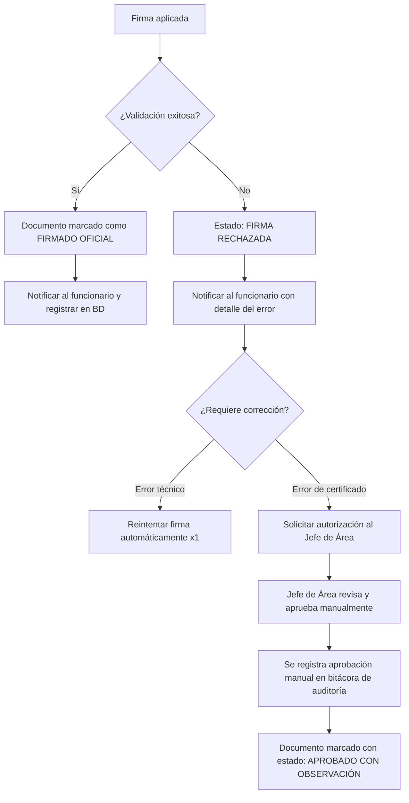

# Evaluación de Riesgos: Integración Firma Digital (Firma Perú)
> **Proyecto:** SIGTRAM3 — Municipalidad de Puente Piedra
> **Documento tipo:** Risk Assessment Técnico + Decisiones de Diseño
> **Autor:** Área de TI / Arquitecto de Software
> **Fecha:** 2026-06-18
> **Referencia arquitectónica:** `GEMINI.md → INT-03`, `Arquitectura.md → §3 FirmaCore`

---

## 1. Contexto

La integración con la Plataforma Nacional de Firma Digital ([Firma Perú](https://www.gob.pe/22271)) es uno de los componentes más complejos del sistema. Este documento evalúa los riesgos operativos, técnicos y de negocio identificados, junto con sus decisiones de mitigación.

---

## 2. Inventario de Riesgos

### RIESGO-01: Rollout del Agente Local (ReFirma Componente)
| Campo | Detalle |
|-------|---------|
| **Descripción** | El Modo Firma Local requiere instalar el componente `ReFirma` en cada PC de funcionario que deba firmar. |
| **Probabilidad** | Media |
| **Impacto** | Alto |
| **Responsable de mitigación** | Área de Soporte TI |

**Decisión tomada:**
- El **Área de Soporte TI** es responsable del rollout e instalación del agente en las estaciones de trabajo.
- Se creará un **Manual de Instalación y Uso Local** en `doc/manuales/firma_local_manual_usuario.md` que podrá ser entregado a los funcionarios para auto-instalación supervisada.
- El sistema debe detectar si el agente no está instalado y mostrar un mensaje claro al usuario con el enlace de descarga oficial.

**Flujo de error propuesto:**
```
[Funcionario hace clic en "Firma Local"]
       ↓
[Sistema detecta que agente no responde]
       ↓
[Muestra modal: "Agente de firma no detectado"]
[Botón: Descargar Agente | Botón: Ir a Firma en la Nube]
```

---

### RIESGO-02: WebSocket bloqueado por Firewall Corporativo
| Campo | Detalle |
|-------|---------|
| **Descripción** | El componente ReFirma comunica con el navegador vía WebSocket local. Algunos firewalls corporativos bloquean WebSockets en puertos no estándar. |
| **Probabilidad** | Media |
| **Impacto** | Alto |

**Decisión tomada:**
- Antes de implementar el módulo de firma, el **Administrador de Redes** debe verificar y habilitar el puerto WebSocket requerido por Firma Perú (generalmente `localhost:19080` o similar).
- Si el firewall bloquea definitivamente WebSockets internos, el usuario debe ser redirigido automáticamente al **Modo Nube** como fallback.
- Documentar en `doc/infraestructura/puertos_requeridos.md` los puertos necesarios.

**Acción previa al desarrollo:** Realizar una prueba de conectividad en al menos un PC de la municipalidad antes de comprometer tiempo de desarrollo en Modo Local.

---

### RIESGO-03: Costo Transaccional de Firma en la Nube
| Campo | Detalle |
|-------|---------|
| **Descripción** | La Firma en la Nube (HSM de RENIEC) puede tener costo por transacción o por suscripción según el contrato con la plataforma. |
| **Probabilidad** | Alta (el costo existe) |
| **Impacto** | Presupuestario |

**Decisión tomada:**
- **El módulo se construirá completamente listo para activación**, con variables `.env` de configuración (`FIRMA_NUBE_ENDPOINT`, `FIRMA_NUBE_API_KEY`).
- La evaluación del costo y aprobación presupuestal la gestiona el Área de TI con la Gerencia Municipal.
- Estimado de volumen de firmas/mes requerido para negociar tarifa: **relevar con cada gerencia cuántos documentos firman por mes** antes de contratar.
- Mientras no esté habilitada, el sistema mostrará la opción en modo "Próximamente" o solo habilitará Firma Local.

---

### RIESGO-04: LibreOffice Headless — Fuentes no instaladas
| Campo | Detalle |
|-------|---------|
| **Descripción** | La conversión de `.docx` a `.pdf` con LibreOffice falla silenciosamente si las fuentes usadas en las plantillas Word no están instaladas en el servidor. |
| **Probabilidad** | Alta |
| **Impacto** | Alto (documentos oficiales con formato roto) |

**Decisión tomada:**
- **Entorno de producción:** El servidor PHP nativo (sin Docker) tendrá LibreOffice instalado directamente. Esto es correcto y simplifica el manejo de fuentes: se instalan con `apt install libreoffice-writer fonts-liberation fonts-dejavu`.
- **Entorno de desarrollo local:** Los desarrolladores que usen Laragon/WAMP/XAMPP deben tener LibreOffice instalado localmente y disponible en el PATH.
- **Regla de plantillas:** Las plantillas `.docx` oficiales **solo pueden usar fuentes del paquete Liberation** (Liberation Sans, Liberation Serif) o DejaVu, que están disponibles en todos los entornos Linux/Windows con LibreOffice.
- **POC obligatorio:** Antes de implementar `DocumentGeneratorCore`, ejecutar la conversión de una plantilla de prueba en el servidor de desarrollo y verificar el resultado visual.

**Comando de instalación en servidor Ubuntu/Debian:**
```bash
apt-get install -y libreoffice-writer-nogui fonts-liberation fonts-dejavu-core
```

**Prueba de conversión:**
```bash
soffice --headless --convert-to pdf --outdir /tmp /path/to/test.docx
```

---

### RIESGO-05: PDF Rechazado por el Validador de Firma Perú
| Campo | Detalle |
|-------|---------|
| **Descripción** | El Validador de Firma Perú puede rechazar un PDF firmado si hay problemas con el certificado, la cadena de confianza o el formato del documento. |
| **Probabilidad** | Baja-Media |
| **Impacto** | Muy Alto (documento oficial inválido jurídicamente) |

**Decisión tomada:**
- El sistema **nunca debe marcar un documento como firmado oficialmente** hasta recibir confirmación exitosa del Validador.
- Si la validación falla, el flujo es el siguiente:



**Estados del documento en BD:**
| Estado | Código | Descripción |
|--------|--------|-------------|
| Borrador | `BOR` | Word generado, sin convertir |
| PDF Generado | `PDF` | Convertido a PDF, pendiente de firma |
| Firma Pendiente | `FIR_PEN` | Enviado a firmar, esperando respuesta |
| Firmado Oficial | `FIR_OK` | Firma validada exitosamente |
| Firma Rechazada | `FIR_ERR` | Validación fallida, requiere revisión |
| Aprobado con Obs. | `APR_OBS` | Autorización manual de Jefe de Área |

---

### RIESGO-06: Concurrencia en Generación de Documentos
| Campo | Detalle |
|-------|---------|
| **Descripción** | Si dos funcionarios generan el PDF del mismo expediente simultáneamente, pueden pisarse los archivos. |
| **Probabilidad** | Baja |
| **Impacto** | Medio |

**Decisión tomada:**
- Usar `Cache::lock('doc_gen_{expediente_id}', 30)` para prevenir generación concurrente del mismo documento.
- El nombre de archivo del PDF generado incluirá timestamp + hash único del expediente.

---

## 3. Matriz de Riesgos Resumida

| ID | Riesgo | Prob. | Impacto | Estado |
|----|--------|:-----:|:-------:|--------|
| R-01 | Rollout agente local | Media | Alto | ✅ Mitigado: Soporte TI + Manual |
| R-02 | WebSocket bloqueado | Media | Alto | ⚠️ Pendiente: POC en red municipal |
| R-03 | Costo firma nube | Alta | Presup. | ⚠️ Pendiente: Evaluar con Gerencia |
| R-04 | LibreOffice fuentes | Alta | Alto | ✅ Mitigado: Fuentes Liberation |
| R-05 | PDF rechazado validador | Baja-Med | Muy Alto | ✅ Mitigado: Flujo con jefe de área |
| R-06 | Concurrencia generación | Baja | Medio | ✅ Mitigado: Cache::lock |

---

## 4. Pre-requisitos Técnicos Antes de Implementar

- [ ] POC: Instalar LibreOffice en servidor dev y convertir plantilla Word con fuentes Liberation
- [ ] POC: Probar WebSocket del agente ReFirma en 1 PC de la municipalidad
- [ ] Obtener credenciales de prueba (sandbox) de Firma Perú
- [ ] Definir la lista de cargos que usarán Firma Local vs. Firma Nube
- [ ] Crear `doc/manuales/firma_local_manual_usuario.md`
- [ ] Agregar columna de estado de documento en tabla correspondiente (script SQL en `doc/sql/`)

---

## 5. Referencias

- [Plataforma Firma Perú](https://www.gob.pe/22271-acceder-a-la-plataforma-nacional-de-firma-digital-firma-peru)
- [Componente Firmador](https://www.gob.pe/22273)
- [Componente Validador](https://www.gob.pe/22274)
- Arquitectura: `GEMINI.md → INT-03`
- Propuesta: `Arquitectura.md → §3 FirmaCore`
