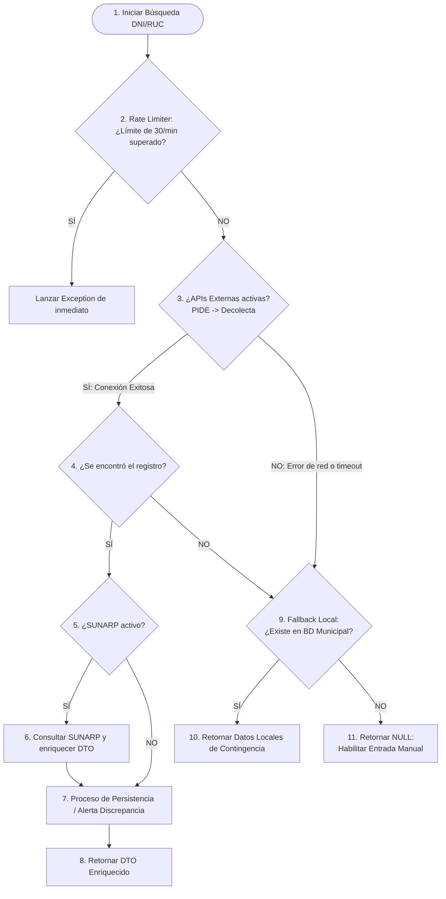

# Flujo Detallado de Consultas e Integración: PIDE, SUNARP y Base de Datos Local

Este documento explica en detalle la arquitectura y secuencia de ejecución lógica del servicio `PideCore` al gestionar consultas de ciudadanos (**DNI**) y empresas (**RUC**) en el sistema **SIGTRAM3**, detallando cómo interactúan los proveedores externos, los de complemento (SUNARP) y las contingencias locales.

---

## 🏛️ 1. Diferencia entre Inyección (Constructor) y Ejecución (Métodos)

Es fundamental entender que la asignación de proveedores en el constructor de la clase **no realiza ninguna consulta a redes ni bases de datos**. Solo almacena referencias a los servicios listos para ser consumidos en memoria:

```php
// En el constructor se inyectan las dependencias pero NO se consulta nada
public function __construct(
    PideProvider $pideProvider,          // Canal oficial PIDE
    DecolectaProvider $decolectaProvider, // Canal Decolecta
    SunarpProvider $sunarpProvider,       // Complemento de SUNARP
    LocalProvider $localProvider          // Contingencia local
) {
    $this->localProvider = $localProvider;
    $this->sunarpProvider = $sunarpProvider;
    // ...
}
```

La consulta real a las APIs e inserciones de base de datos se ejecutan **de forma secuencial y bajo demanda (Lazy Evaluation)** cuando el operador digita el documento en la interfaz y se llama a los métodos del servicio.

---

## 📊 2. Diagrama de Secuencia y Cascada Lógica

La ejecución del flujo sigue un orden estrictamente secuencial para garantizar la frescura del dato, prevenir bloqueos y asegurar que el operador pueda seguir registrando trámites incluso ante fallos catastróficos de red:



---

## 🚶‍♂️ 3. Paso a Paso de las Fases del Flujo

### Fase A: Control de Seguridad (Rate Limiting)
Antes de realizar cualquier conexión externa o consulta pesada a base de datos, el orquestador verifica la tasa de uso en memoria.
*   **Límite**: Máximo 30 consultas por minuto por cada código de login de usuario (`cdgo_lgin`) o IP de terminal.
*   **Acción**: Si se supera, lanza una excepción que se reporta al frontend en menos de 1ms, previniendo scraping o ataques DoS internos.

### Fase B: Obtención de Identidad Primaria (Cascada Externa)
Se recorren secuencialmente los proveedores asignados al canal de identidad base:
1.  **PideProvider (RENIEC/SUNAT)**: Es el primer canal oficial en consultarse para asegurar datos oficiales actualizados al segundo.
2.  **DecolectaProvider (Respaldo)**: Si el canal oficial PIDE sufre un timeout o caída de red, el flujo pasa de forma transparente al proveedor Decolecta para recuperar nombres y apellidos básicos.

### Fase C: Enriquecimiento Opcional (SUNARP)
Si la fase B recupera con éxito la identidad del ciudadano o la empresa, y el switch de SUNARP está encendido (`PIDE_USAR_SUNARP=true`), el orquestador llama al método `complementarConSunarp`:
*   **Para RUC**: Consulta a SUNARP la lista de apoderados y representantes legales de la empresa, inyectándolos en el campo `$representantesLegales` de `EmpresaDto`.
*   **Para DNI**: Consulta a SUNARP los bienes inscritos (vehículos o predios), inyectándolos en el campo `$bienes` de `PersonaDto`.
*   **Blindaje ante Caídas**: Esta consulta está aislada en un bloque `try-catch` independiente. Si la API de SUNARP está inactiva o lenta, el error se registra silenciosamente y el flujo continúa, entregando al operador al menos la identidad oficial recuperada en la fase B.

### Fase D: Persistencia y Control de Discrepancias
Si la consulta externa trajo resultados en vivo:
*   **Si el ciudadano/empresa es nuevo**: Se inserta de forma limpia y transparente en la base de datos municipal (`p_usrios` + `h_usrios_ntral` / `h_usrios_jrid`) para asignarle su `cdgo_usrios` transaccional.
*   **Si ya existía pero hay diferencias**: El sistema **no** sobrescribe los datos históricos locales de forma automática. En su lugar, el DTO se marca con `tieneDiscrepancia = true` y retorna tanto los datos oficiales como los locales. Esto le muestra al operador municipal un modal comparativo para validar y confirmar la actualización de forma manual.

### Fase E: Contingencia por Caída Total de Red
Si los pasos anteriores fallaron debido a cortes de internet o servidores estatales caídos, entra en acción la base de datos local:
1.  **LocalProvider**: Busca al ciudadano/empresa dentro de la base de datos municipal histórica. Si lo encuentra, retorna el registro (latencia < 5ms).
2.  **Entrada Manual**: Si tampoco se encuentra registrado en el municipio, el servicio retorna `null` y activa un aviso en el frontend que **desbloquea los campos del formulario** para que el operador digite los datos a partir del documento físico y continúe el trámite.

---

## 🎛️ 4. Configuración del Flujo en `.env`

Puedes ajustar el comportamiento del flujo en vivo modificando las variables del entorno:

```env
# Control de proveedores activos
PIDE_USAR_OFICIAL=true      # Habilita PideProvider (Paso 1)
PIDE_USAR_SUNARP=true       # Habilita SunarpProvider (Paso 2 - Complemento)
PIDE_USAR_DECOLECTA=true    # Habilita DecolectaProvider (Paso 3 - Respaldo)
PIDE_USAR_LOCAL=true        # Habilita LocalProvider (Plan B - Contingencia)

# Límite de espera de conexiones externas (segundos)
PIDE_TIMEOUT=3
```
