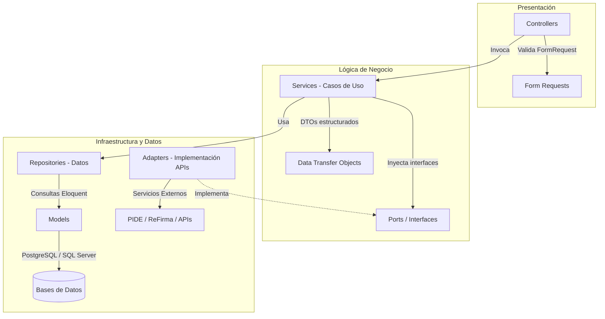
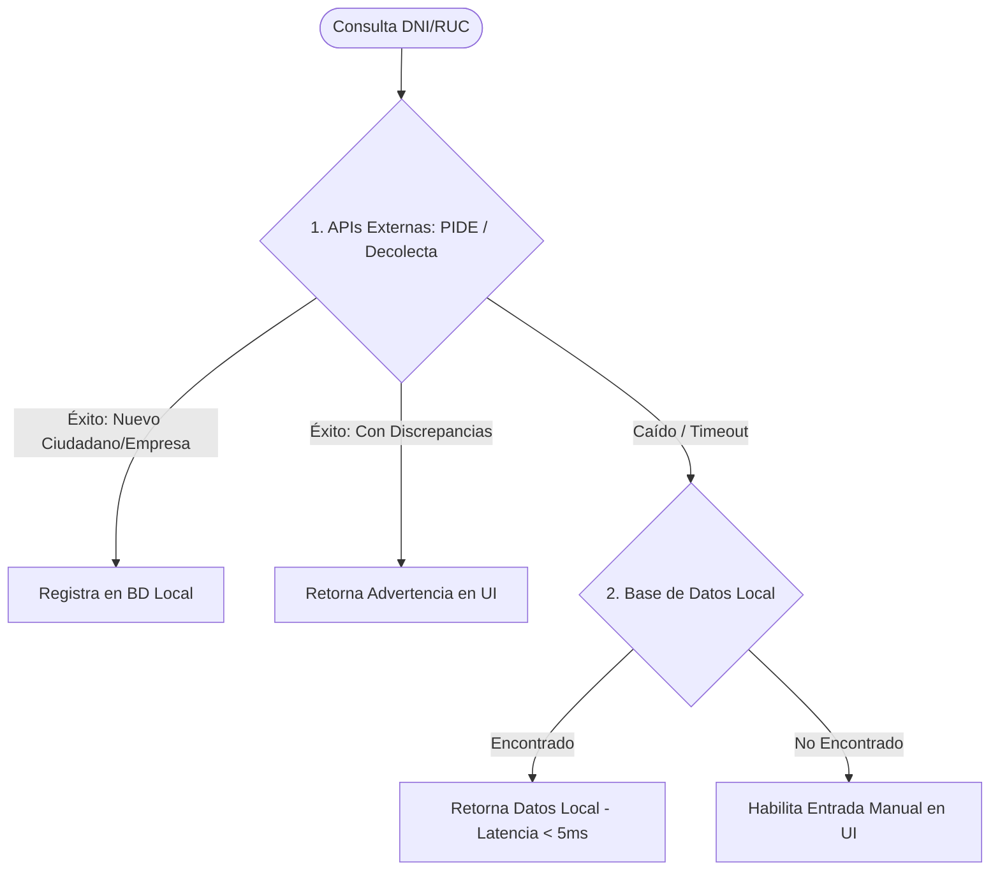

# Propuesta de Modernización Tecnológica: Migración a SIGTRAM3

## Arquitectura, Seguridad, Escalabilidad y Firma Digital

_Oficina de Tecnologías de Información / Desarrollo_

---

## 1. El Reto: Diagnóstico del Sistema Legacy

### Problemas Actuales (Deuda Técnica)

- **Arquitectura acoplada:** Código de negocio y consultas SQL mezcladas en las vistas.
- **Seguridad vulnerable:** Credenciales expuestas en archivos planos, sin trazabilidad inmutable.
- **Procesos lentos:** Generación manual de PDFs, llamadas externas sin caché.

---

## 2. La Solución: Visión SIGTRAM3

### Modernización con Laravel 13+ y Clean Architecture

- **Orientación a Dominios (DDD):** Modularización por contexto de negocio.
- **Arquitectura Hexagonal (Desacoplada):**
    - **Core Limpio:** El negocio no depende de bases de datos ni APIs externas.
    - **Fácil de Intercambiar:** Cambiar de pasarela o API solo requiere cambiar su Adaptador.
- **DTOs y Tipado Estricto:** Eliminación de errores en tiempo de ejecución.

---

## 3. Arquitectura Modular del Sistema

---

## 4. Servicios Core Centralizados (Los "Núcleos")

- **`SecurityCore`**: Permisos y excepciones por usuario resueltos en una sola consulta con caché en Redis.
- **`NotificationCore`**: Canal asíncrono único (WhatsApp, Email, SMS) mediante colas Redis.
- **`AuditCore (Audit Trail)`**: Bitácora inmutable en base de datos (JSON Diffing automático).
- **`AdjuntosCore`**: Subida segura, validación de Mime-Type real y distribución por fecha (`storage/app/documentos/YYYY/MM/DD/`).
- **`BdCore`**: Conexión centralizada a bases de datos auxiliares mediante _Lazy Loading_.

---

## 5. Generación de Documentos y Firma Digital

### Flujo de Documentos (`DocumentGeneratorCore`)

- **Plantillas Word (`.docx`):** Fácil edición de marcadores `${PLACEHOLDERS}` por administración.
- **Conversión Headless:** Conversión automática a PDF en servidor mediante LibreOffice.
- **Soporte Híbrido Flex:**
    1. _Flujo Directo:_ Generación instantánea y pase a firma (sin descargas).
    2. _Flujo con Edición:_ Descarga del Word, modificación manual y subida para PDF final.

---

## 6. Firma Digital Centralizada (Firma Perú - PCM)

Integración bajo el puerto `FirmaCore` utilizando la plataforma oficial del Estado:

- **Firma con ReFirma PC (Modo Local):**
    - Invoca mediante WebSockets al componente local de la PC del funcionario.
    - Firma con **DNI electrónico (DNIe)** con lector inteligente o **Token USB**.
    - **Costo Cero** transaccional para la municipalidad.
    - _Nota: Limitado a entornos de escritorio/PC (no compatible con celulares o tablets)._
- **Firmado Desatendido (En Servidor):**
    - Integración con el componente **Agente de Firma Perú** en el servidor para firmas automáticas y desatendidas.
- **Bypass de Firma Corrupta:** Si falla la firma de un externo en Mesa de Partes, se exige clave del Jefe de Área para continuar bajo auditoría.

---

## 7. Consultas Ciudadanas Inteligentes (`PideCore`)

Orquestador de consultas de DNI/RUC en cascada para optimizar velocidad y costos de llamadas externas:

- **Lógica de Cascada Híbrida**: APIs Externas (PIDE -> Decolecta) -> Fallback Local -> Fallback Manual.
- **Prevención de Sobreescrituras**: Detección de discrepancias para evitar el reemplazo silencioso de datos locales preexistentes.
- **Control en Caliente y Rate Limit**: Activación de proveedores vía `.env` y límite de 30 consultas/minuto por IP o login.

---

## 8. Seguridad Avanzada & OWASP Top 10 (2025)

- **Control de Acceso (A01):** Policies y Gates nativos para bloquear manipulación de IDs en rutas.
- **Cifrado (A04):** Contraseñas Bcrypt (migración transparente desde SHA1) y encriptación AES-256 de DNI/celular.
- **Inyección (A05):** Bloqueo de consultas crudas (`DB::raw`); uso mandatorio de bindings PDO.
- **Cadena de Suministro (A03):** Auditoría automática de paquetes (`composer audit`) en pipeline de CI/CD.
- **Doble Envío:** Candados atómicos en caché (`Cache::lock`) para evitar transacciones duplicadas por doble clic.

---

## 9. Rendimiento y Escalabilidad de Datos

- **Caché Redis:** Compilación de la matriz de accesos en caché, eliminando consultas redundantes.
- **Transaccionalidad:** Uso mandatorio de `DB::transaction()` para operaciones multi-tabla.
- **Correlativos Seguros:** Generación de números de expedientes mediante secuencias nativas PostgreSQL.
- **Workers en Segundo Plano:** Redis + Horizon para derivar tareas pesadas (notificaciones, PDFs).
- **Soft Deletes:** Desactivación lógica de registros para mantener inmutabilidad histórica.

---

## 10. Diseño Tolerante a Actualizaciones (Future-Proofing)

- **Wrappers de Terceros:** Las librerías externas se encapsulan tras interfaces (Puertos).
- **Análisis Estático:** **PHPStan/Larastan** en nivel 5+ integrado en el flujo de desarrollo.
- **Red de Seguridad:** Suite de pruebas automatizadas (Pest) con 80% de cobertura mínima en lógica de negocio.
- **Validación de Framework:** La actualización de Laravel se verifica en segundos corriendo los tests.

---

## 11. Diseño Visual Premium & Modo Dual

- **SPA Look & Feel:** Interfaz responsiva y fluida sin recargas de pantalla.
- **Tokens de Diseño:** Colores estandarizados mediante variables CSS (`var(--color-primary)`).
- **Modo Light / Dark:** Soporte nativo y persistido en `localStorage`.
- **Tematización Dinámica:**
    - Carga de colores y logotipos desde la base de datos según la entidad activa.
    - Inyección en caliente en el dashboard sin recompilar assets de frontend.

---

## 12. Plan de Acción y Siguientes Pasos

### Cronograma de Migración Recomendado

1. **Andamiaje Inicial:** Configuración de Calidad (PHPStan, Pest), variables CSS del Design System y esqueleto modular.
2. **Implementación de Núcleos:** Desarrollo de `SecurityCore`, `FirmaCore`, `PideCore` y `DocumentGeneratorCore`.
3. **Migración de Módulos:** Traspaso modular de lógica de trámites de SIGTRAM legacy a SIGTRAM3.
4. **Pruebas y Lanzamiento:** Pruebas de carga, auditoría de seguridad y despliegue automatizado.
