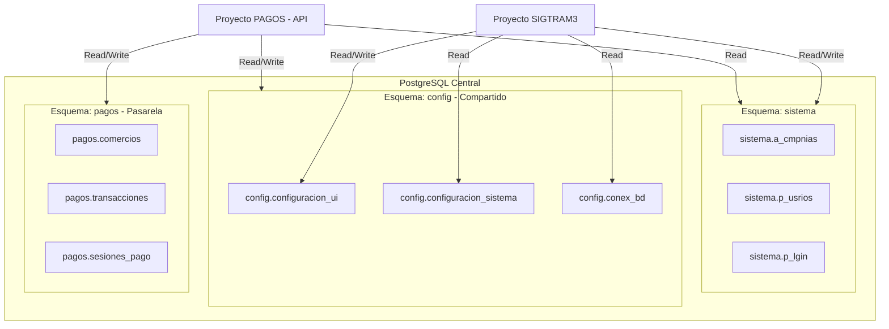

# Sincronización y Coordinación de Base de Datos

## Proyectos: SIGTRAM3 y PAGOS (Esquema Centralizado Compartido)

Este documento define la arquitectura de base de datos compartida, la propiedad de los esquemas, el mapeo de tablas cruzadas y las tareas coordinadas de los equipos de desarrollo de **SIGTRAM3** y **PAGOS** para garantizar que no existan conflictos de datos, duplicación de información o colisiones de DDL/DML.

---

## 1. Arquitectura General y Propiedad de Esquemas

Ambos proyectos se conectan a un único servidor PostgreSQL centralizado. La base de datos se divide en tres esquemas lógicos con responsabilidades y accesos bien definidos:



### Tabla de Permisos y Propiedad:

| Esquema       | Propósito                                                                                                        | Proyecto Propietario (Write)      | Proyectos Lectores (Read)                           | Estado de Migración                                      |
| :------------ | :--------------------------------------------------------------------------------------------------------------- | :-------------------------------- | :-------------------------------------------------- | :------------------------------------------------------- |
| **`sistema`** | Control de accesos de empleados, perfiles, cargos y catálogo de compañías de SIGTRAM.                            | **SIGTRAM3**                      | **PAGOS** (Solo lectura para validación de tenants) | Existente (Heredado)                                     |
| **`config`**  | Configuración compartida de multi-tenant (identidad visual, parámetros técnicos y conexiones externas).          | **PAGOS / SIGTRAM3** (Compartido) | Ambos proyectos                                     | **Nuevo** (Definido en `crear_tablas_configuracion.sql`) |
| **`pagos`**   | Tablas transaccionales de la pasarela de pagos (comercios, tokens, sesiones, transacciones, auditoría de pagos). | **PAGOS**                         | **PAGOS** (SIGTRAM3 no interactúa directamente)     | **Nuevo** (Definido en `schema_pagos.sql`)               |

---

## 2. Definición de Tablas Compartidas (Esquema `config`)

Para eliminar la tabla obsoleta `pagos.municipios` y evitar columnas de personalización visual directamente en `sistema.a_cmpnias`, se definen las siguientes tablas en el esquema `config`:

### 2.1. `config.configuracion_ui` (Relación 1:1 con `sistema.a_cmpnias`)

Centraliza los colores de marca, logotipos y títulos del checkout y el sistema.

- **Llave Primaria:** `cdgo_configuracion_ui`
- **Llave Foránea:** `cdgo_cmpnia` (Referencia a `sistema.a_cmpnias(cdgo_cmpnia)`, tipo `UNIQUE` para asegurar la relación 1:1).
- **Campos Principales:**
    - `co_colr_prim` (Hexadecimal, ej: `#0F5132`)
    - `co_colr_secu` (Hexadecimal, ej: `#D1E7DD`)
    - `de_path_logo` (Ruta o URL de imagen de logo principal)
    - `de_path_logo_movil` (Ruta o URL de imagen optimizada para móviles)
    - `de_path_favicon` (Favicon para navegador)
    - `de_path_fondo` (Fondo de checkout opcional)
    - `de_titlo_chckout` (Texto de cabecera personalizado)

### 2.2. `config.configuracion_sistema` (Parámetros Técnicos Clave-Valor)

Almacena parámetros técnicos y adaptadores activos por tenant o de forma global (cuando `cdgo_cmpnia` es `NULL`).

- **Campos Principales:**
    - `cdgo_cmpnia` (FK a `sistema.a_cmpnias`, NULL permitido para variables globales).
    - `campo` (Clave de parámetro técnico, ej: `adaptador_cuenta_corriente`, `adaptador_papeletas`).
    - `valor` (Valor asignado, ej: `satmun`, `sigtram`).

### 2.3. `config.conex_bd` (Conexiones Dinámicas de Base de Datos)

Almacena dinámicamente las credenciales de conexión para las bases de datos de deudas (SATMUN, Papeletas, etc.) por compañía.

- **Llave Primaria:** `cdgo_conex_bd`
- **Campos Principales:**
    - `cdgo_cmpnia` (FK a `sistema.a_cmpnias`, NULL permitido para globales).
    - `nombre_conexion` (Identificador único de la conexión, ej: `conexion_satmun`).
    - `driver` (Driver de base de datos a usar, ej: `sqlsrv`, `pgsql`, `mysql`).
    - `host` (Dirección IP o dominio).
    - `port` (Puerto de conexión).
    - `database_name` (Nombre de la base de datos).
    - `username` (Nombre de usuario).
    - `password` (Contraseña encriptada en caliente mediante la clase `Crypt` de Laravel).
    - `in_esta` (`bpchar(1)` - '1' = activa, '0' = inactiva).
    - _Auditoría:_ `cdgo_usrios_ins`, `fec_ins`, `cdgo_usrios_upd`, `fec_upd`.

### 2.4. `config.alertas_conectividad` (Registro de Fallos de Conexión)

Almacena alertas de pérdida de conexión o timeouts de bases de datos externas (SATMUN) o pasarelas para monitoreo.

- **Llave Primaria:** `cdgo_alerta`
- **Campos Principales:**
    - `cdgo_cmpnia` (FK a `sistema.a_cmpnias`).
    - `tipo_servicio` (Identificador del servicio, ej: `BD_SATMUN`, `BD_SIGTRAM`, `PASARELA_NIUBIZ`).
    - `mensaje_error` (Detalle técnico de la excepción/timeout).
    - `in_esta` (`bpchar(1)` - '1' = Alerta activa/no resuelta, '0' = Alerta leída/resuelta).
    - _Auditoría:_ `cdgo_usrios_ins`, `fec_ins`, `cdgo_usrios_upd`, `fec_upd`.

---

## 3. Estrategia de Sincronización y Prevención de Conflictos

1. **Sin Migraciones en Laravel (Ni automáticas, ni manuales, ni por IA):**
    - Queda estrictamente prohibido crear, modificar o ejecutar archivos de migración nativos de Laravel (`database/migrations/`).
    - Todos los cambios y estructuras se entregan como scripts SQL puros (`.sql`) en `doc/propuesta/sql/` para ser ejecutados manualmente por el equipo de desarrollo directamente en la base de datos.
2. **Políticas de Integridad Referencial:**
    - Toda tabla compartida o transaccional que referencie a `sistema.a_cmpnias` debe incluir la cláusula `ON DELETE CASCADE`. Si una compañía es dada de baja, todos sus parámetros se purgan automáticamente para evitar registros huérfanos.
3. **Nomenclatura Estandarizada de Columnas:**
    - Columnas de Estado: Usar `in_esta` de tipo `bpchar(1)` ('1' = activo, '0' = inactivo).
    - Columnas de Auditoría: Toda tabla debe contar con:
        - `cdgo_usrios_ins` (INTEGER NOT NULL)
        - `fec_ins` (TIMESTAMP WITH TIME ZONE DEFAULT CURRENT_TIMESTAMP)
        - `cdgo_usrios_upd` (INTEGER NULL)
        - `fec_upd` (TIMESTAMP WITH TIME ZONE NULL)
        - `cdgo_usrios_del` (INTEGER NULL)
        - `fec_del` (TIMESTAMP WITH TIME ZONE NULL)

### 3.4. Seguridad y Encriptación de Conexiones (`DB_CRYPTO_KEY`)
Para evitar exponer contraseñas de bases de datos externas en texto plano en la tabla `config.conex_bd`, estas se almacenarán encriptadas con cifrado fuerte simétrico (AES-256-CBC).
* **Llave de Cifrado Compartida:** Ambos proyectos (**SIGTRAM3** y **PAGOS**) declararán una misma variable en sus archivos `.env` llamada `DB_CRYPTO_KEY`. Se utilizará esta llave específica para encriptar y desencriptar las contraseñas, permitiendo que compartan la misma base de datos sin necesidad de compartir su `APP_KEY` principal.
* **Mitigación de Vulnerabilidades (¿Es vulnerable?):**
  * **No es vulnerable si se aplican buenas prácticas de administración:** La variable `DB_CRYPTO_KEY` reside exclusivamente en el archivo de entorno `.env` en el servidor web. Los archivos `.env` nunca deben subirse al repositorio de código (están en `.gitignore`) y se les asignan permisos de lectura restrictivos a nivel de sistema operativo (solo accesibles por el usuario del servidor web).
  * **Defensa en Profundidad:** Al estar encriptadas en la base de datos, si un atacante lograra vulnerar el sistema mediante SQL Injection (inyección SQL) y descargar las tablas de la base de datos, las contraseñas seguirán siendo **incomprensibles e inútiles** para él, ya que no posee la llave física de descifrado que reside únicamente en el servidor.

---

## 4. Tareas para los Desarrolladores (Roadmap de Coordinación)

### 📋 Equipo de Desarrollo: SIGTRAM3

- [ ] **Tarea S3-01: Remover Columnas Visuales Obsoletas de Compañías**
    - Eliminar cualquier lógica que asuma la existencia de columnas de colores (`color_primario`, etc.) dentro de la tabla `sistema.a_cmpnias`.
    - Migrar el código del Layout del Panel de Administración para consultar `config.configuracion_ui` haciendo un `LEFT JOIN` con `sistema.a_cmpnias` sobre el `cdgo_cmpnia` activo en la sesión del empleado (`session('usComp')`).
- [ ] **Tarea S3-02: Consumo de Variables CSS Dinámicas**
    - Modificar la vista maestra Blade de SIGTRAM3 para inyectar en el `<head>` los valores de colores obtenidos desde `config.configuracion_ui` como variables CSS:
        ```css
        :root {
            --color-primary: {{ $configUi->co_colr_prim ?? '#0F5132' }};
            --color-secondary: {{ $configUi->co_colr_secu ?? '#D1E7DD' }};
        }
        ```
    - Configurar `tailwind.config.js` para mapear estas variables.
- [ ] **Tarea S3-03: Sincronización de Sesiones de Usuario para API**
    - Asegurar que el middleware de autenticación reconozca las credenciales de usuarios del esquema `sistema` para validaciones cruzadas.
- [ ] **Tarea S3-04: Módulo de Auditoría y Conciliación de Pagos**
    - Diseñar una interfaz administrativa en SIGTRAM3 para personal de TI y Tesorería.
    - Consultar (en modo lectura) las tablas `pagos.sesiones_pago`, `pagos.transacciones` y `pagos.registros_auditoria` para mostrar cobros fallidos o con error de asentamiento municipal.
    - Implementar botones de acción para "Verificar en Pasarela en vivo" (API Check) y "Conciliar Manualmente" (forzar el descargo de la deuda en SATMUN/SIGTRAM3).
    - **Reporte de Liquidación Diaria:** Agregar un botón **"Reporte de Liquidación Diaria"** que permita seleccionar una fecha del calendario y descargar al instante el archivo CSV con la agrupación de transacciones, comisiones de pasarela calculadas dinámicamente y el abono neto diario correspondiente a ese día (consumiendo el endpoint `/api/v1/pagos/liquidacion-diaria` de la API de PAGOS).
- [ ] **Tarea S3-05: Panel de Alertas de Conectividad (Dashboard)**
    - Diseñar un widget o banner en el panel de administración de SIGTRAM3 que consulte en tiempo real la tabla `config.alertas_conectividad`.
    - Mostrar alertas rojas o badges visibles si hay registros con `in_esta = '1'` (alerta activa).
    - Permitir al personal administrativo de TI marcar las alertas como "Leídas/Resueltas" (cambiando `in_esta` a `'0'`).

---

### 📋 Equipo de Desarrollo: PAGOS

- [ ] **Tarea PG-01: Configuración de Conexiones Dinámicas en Caliente**
    - Configurar el `ConexionesDinamicasServiceProvider` para mapear las credenciales leídas de `config.conex_bd` hacia el array en memoria de `config('database.connections')`.
    - Implementar el descifrado en caliente de la contraseña (`Crypt::decryptString($conexion->password)`) manejando excepciones de fallback en entornos de desarrollo.
- [ ] **Tarea PG-02: Resolución Dinámica de Adaptadores de Cuenta Corriente**
    - Configurar el `RepositoriosServiceProvider` para consultar `config.configuracion_sistema`.
    - Resolver la inyección del adaptador de cuenta corriente (ej. `SatmunCuentaCorrienteRepository`) basándose en el parámetro de base de datos (`campo = 'adaptador_cuenta_corriente'`) asociado al comercio autenticado.
- [ ] **Tarea PG-03: Referenciar sistema.a_cmpnias en Tablas Maestras de Pagos**
    - Validar que las tablas `pagos.comercios`, `pagos.proveedores_detalle` y `pagos.conf_correo` referencien a `sistema.a_cmpnias` como su única llave foránea multitenant.
- [ ] **Tarea PG-04: Registro de Alertas y Notificación de Conectividad**
    - Capturar excepciones de tipo `QueryException` o fallos de conexión hacia bases de datos externas (SATMUN/SIGTRAM).
    - Si la conexión falla, registrar automáticamente el incidente en `config.alertas_conectividad` con estado `in_esta = '1'`.
    - Encolar una notificación técnica de alta prioridad en Redis a través de `NotificationCore` para alertar de inmediato a los administradores de TI de la municipalidad vía WhatsApp (Whapi) o correo electrónico.

---

## 5. Script de Inicialización (Orden de Ejecución)

Para desplegar estos cambios sin conflictos, el Administrador de Base de Datos (DBA) o desarrollador asignado debe ejecutar los scripts en el siguiente orden estricto:

1. **`crear_tablas_configuracion.sql`**: Crea el esquema `config`, agrega las llaves foráneas a las tablas existentes e inicializa los parámetros UI y de conexión base para los tenants.
2. **`schema_pagos.sql`**: Crea el esquema transaccional `pagos` y todas sus tablas hijas asociadas a las pasarelas.
3. **`insert_pagos.sql`**: Carga las semillas por defecto y credenciales mock de pasarelas de prueba.
